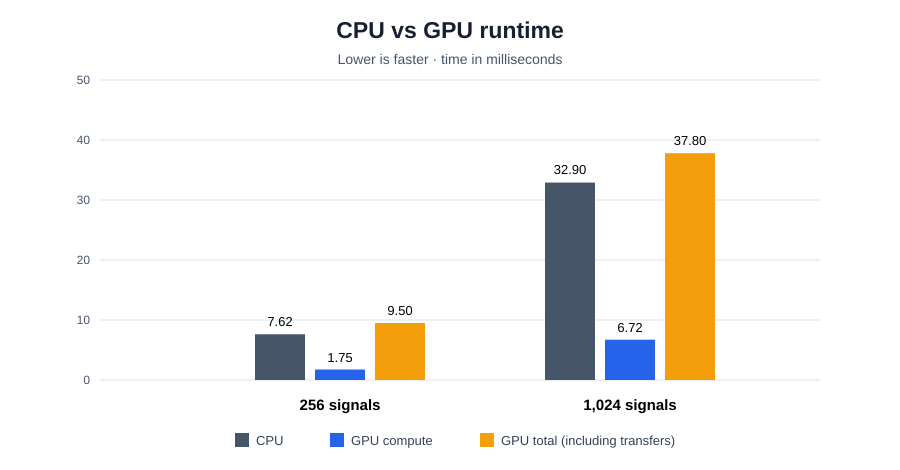
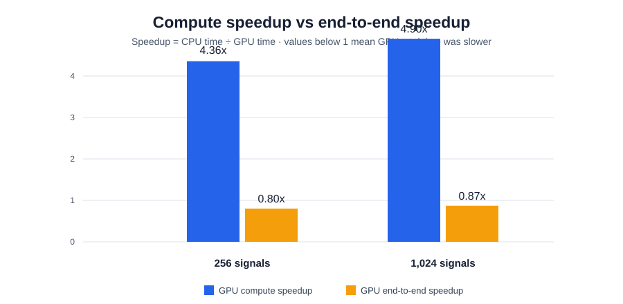

# CUDA Signal Processing Capstone

A CUDA/C++ comparison of batched FFT low-pass filtering on the CPU and GPU. The project generates noisy signals containing 50 Hz, 200 Hz, and 500 Hz components, filters frequencies above 250 Hz, and compares runtime and numerical output using FFTW (CPU) and NVIDIA cuFFT (GPU).

## Why this project

I wanted to apply GPU programming to a practical signal-processing workload and understand when GPU acceleration helps in practice. The experiment separates GPU kernel/FFT computation from end-to-end time so that host-device transfer costs are visible alongside compute speedup.

## What it does

- Generates reproducible noisy signals (seed 42) with a configurable number of signals, samples, sample rate, noise level, and output path.
- Runs an FFT low-pass filter on the CPU with FFTW and on the GPU with CUDA and cuFFT.
- Writes filtered CSV files and measures processing time.
- Includes benchmark CSV tables and vector plots from the completed runs under `results/`.

The GPU implementation uses batched cuFFT transforms and CUDA kernels for frequency-bin filtering and normalization. This is GPU code; the CPU implementation is provided as a baseline, not as a substitute for the CUDA implementation.

## Results from the submitted runs

| Signals | Total samples | CPU (ms) | GPU compute (ms) | GPU end-to-end (ms) | Compute speedup | End-to-end speedup |
|---:|---:|---:|---:|---:|---:|---:|
| 256 | 1,048,576 | 7.62152 | 1.74906 | 9.50064 | 4.36x | 0.80x |
| 1,024 | 4,194,304 | 32.9047 | 6.71670 | 37.8017 | 4.90x | 0.87x |

Compute speedup compares CPU processing time with GPU compute time. End-to-end speedup compares CPU processing time with GPU total time, including memory transfers. The GPU computes faster in both cases, while transfer and setup costs make total GPU time longer in these recorded runs. Results depend on GPU, CPU, CUDA version, and measurement conditions. The original archive does not record the exact GPU model.

The included accuracy CSV reports zero maximum absolute error, mean absolute error, and RMSE at the saved CSV precision. See `results/accuracy_results.csv` and `results/final_performance.csv`.

## Results plots





## Repository contents

- `signal_generator.cpp`, `cpu_processing.cpp`, `gpu_processing.cu`: source code.
- `run.sh`: build and execute both workload sizes.
- `results/`: compact benchmark CSV files and SVG performance plots from the submitted execution.
- `data/` and `output/`: generated at runtime; large generated CSVs are intentionally not checked in. Run the generator and processing programs to recreate them.
- `project_description.md`: project write-up.
- `PRESENTATION.md`: 5–10 minute demonstration outline.

Prebuilt executables and machine-specific build artifacts are excluded. Run `run.sh` to compile locally.

## Requirements and installation

This project was developed for a Linux environment with an NVIDIA CUDA-capable GPU (the original submission reports Google Colab as its environment). You need:

- NVIDIA GPU with a working driver
- CUDA Toolkit, including `nvcc` and cuFFT
- g++ with C++17 support
- FFTW3 development library

On Ubuntu/Colab, install FFTW3 and check CUDA availability:

```bash
sudo apt-get update
sudo apt-get install -y g++ libfftw3-dev
nvcc --version
nvidia-smi
```

Install the NVIDIA CUDA Toolkit using the instructions for your Linux distribution and GPU. cuFFT is included with the CUDA Toolkit. On hosted notebooks, select a GPU runtime and verify that `nvcc` and `nvidia-smi` are available before building. The original results do not include the GPU model or software version, so these should be recorded when reproducing the experiment.

## Build and run

From the repository root:

```bash
chmod +x run.sh
./run.sh
```

The script compiles the generator, CPU program, and CUDA program, generates 256- and 1,024-signal datasets, and runs both implementations. Generated CSV files are written beneath `data/` and `output/`.

You can also run individual commands:

```bash
g++ -O2 -std=c++17 signal_generator.cpp -o signal_generator
g++ -O2 -std=c++17 cpu_processing.cpp -lfftw3 -o cpu_processing
nvcc -O2 -std=c++17 gpu_processing.cu -lcufft -o gpu_processing

mkdir -p data output
./signal_generator 256 4096 2048 0.2 data/input_signals.csv
./cpu_processing 256 4096 250 data/input_signals.csv output/cpu_output.csv
./gpu_processing 256 4096 250 data/input_signals.csv output/gpu_output.csv
```

Arguments for `signal_generator`: `[signal_count] [samples_per_signal] [sample_rate_hz] [noise_amplitude] [output_csv]`.

Arguments for CPU/GPU processing: `[signal_count] [samples_per_signal] [cutoff_hz] [input_csv] [output_csv]`.

## Reproducing and interpreting the results

The included `run.sh` regenerates the workloads and outputs. Runtime measurements will vary by hardware and environment; compare both GPU compute time and GPU end-to-end time. The submitted benchmark figures are historical measurements and may not be reproduced exactly on another GPU or runtime.

## License

No license was provided in the original project. Add a license if you want others to reuse or redistribute this code.


